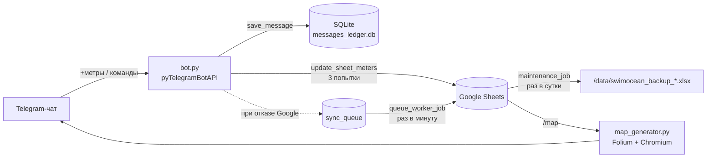

# SwimOceanBot

Telegram-бот клуба плавания SwimOcean. Участники пишут в общий чат сообщения вида `+1500`, бот записывает проплытые метры в Google-таблицу клуба, показывает личную и общую статистику и рисует карту виртуального заплыва: суммарный метраж клуба откладывается вдоль маршрута из точек на реальной карте.

Смежный проект — веб-карта на Streamlit: <https://swimocean.streamlit.app/>. Она работает с той же Google-таблицей и живёт в отдельном репозитории.

## Содержание

- [Возможности](#возможности)
- [Команды бота](#команды-бота)
- [Архитектура](#архитектура)
- [Структура репозитория](#структура-репозитория)
- [Google-таблица](#google-таблица)
- [Переменные окружения](#переменные-окружения)
- [Добавление участника](#добавление-участника)
- [Локальный запуск](#локальный-запуск)
- [Запуск в Docker](#запуск-в-docker)
- [Деплой на Amvera](#деплой-на-amvera)
- [Данные и бэкапы](#данные-и-бэкапы)
- [Известные особенности](#известные-особенности)

## Возможности

- Запись метров сообщением `+<метры>` за сегодня или `+<метры> ДД.ММ.ГГГГ` за прошедшую дату. Будущие даты отклоняются.
- Корректная обработка редактирования: если участник исправил `+1000` на `+1200`, в таблицу уходит только разница (+200).
- Отказоустойчивая запись: три попытки с паузой. Если Google API недоступен, запись кладётся в локальную очередь SQLite и досылается фоновым потоком.
- Личная статистика по месяцам (`/stat_my`) и столбчатая диаграмма по всем участникам за текущий месяц (`/stat_all`).
- Карта текущего положения клуба на маршруте (`/map`). Генерируется через Folium и рендерится в PNG headless-Chromium.
- Выгрузка таблицы метров в Excel (`/get_table`).
- Ежедневный бэкап листов с метрами и пользователями в `.xlsx`, хранятся последние 14 дней.
- Telegram ID и имена участников хранятся в таблице в зашифрованном виде (Fernet).


### Для участников

| Сообщение / команда | Действие |
|---|---|
| `+1000` | Записать 1000 м за сегодня |
| `+1000 19.04.2025` | Записать 1000 м за указанную дату (не в будущем) |
| `/start` | Приветствие |
| `/help` | Справка по формату записи и командам |
| `/map` | PNG-карта с текущим положением на маршруте |
| `/stat_my` | Личная статистика: объём и число тренировок по месяцам с `START_DATE` |
| `/stat_all` | Диаграмма метража всех участников за текущий месяц |

После успешной записи бот ставит на сообщение реакцию ✍. Если за день это уже не первая тренировка, бот дополнительно отвечает итогом за день. На ошибку формата бот ставит 👎 и отвечает подсказкой.

### Служебные (не указаны в `/help`)

| Команда | Кто может | Действие |
|---|---|---|
| `/get_table` | Участники из `UsersDB` | Присылает лист `МетрыV2` файлом `SwimOcean_Metres_ДД-ММ-ГГГГ.xlsx` |
| `/getid` | Только `ADMIN_IDS` | Вызывается **ответом** на сообщение пользователя. Бот присылает админу в личку имя, Telegram ID и username автора, а саму команду удаляет из чата. Нужна, чтобы узнать ID для `UsersDB`. |

Чтобы `/getid` мог писать админу в личку, админ должен хотя бы раз запустить бота в личных сообщениях.

## Архитектура



При старте `bot.py` делает следующее:

1. Создаёт таблицы SQLite (`db.init_db()`).
2. Запускает два фоновых daemon-потока. Поток бэкапов `maintenance_job` стартует через 15 секунд и дальше работает раз в сутки. Воркер очереди синхронизации `queue_worker_job` стартует через 20 секунд и проверяет очередь раз в минуту.
3. Загружает из листа `UsersDB` словарь `user_column_map` (`telegram_key → Full_Name`), расшифровывая обе колонки.
4. Запускает `bot.infinity_polling()`.

Ключевые моменты:

- **Идентификация участника** (`get_user_key`): сначала ищется числовой Telegram ID, затем `username`. Если у пользователя нет username, ищется `first_name`. Найденный ключ сопоставляется с `Full_Name`, а `Full_Name` — с заголовком колонки в листе `МетрыV2`.
- **Запись в таблицу** (`_apply_sheet_delta`): бот находит строку по дате в колонке A и колонку по имени в первой строке, читает текущее значение ячейки и записывает `текущее + delta`. Поэтому повторные тренировки за день суммируются, а при редактировании сообщения уходит только разница.
- **Локальный журнал** `messages`: хранит `message_id → метры`. Он нужен, чтобы при редактировании вычислить дельту и посчитать число тренировок за день. Сообщения, отправленные до появления журнала, отредактировать нельзя: бот попросит прислать новое сообщение.
- **Очередь синхронизации** `sync_queue`: если три попытки записи в Google провалились, дельта сохраняется со статусом `pending`. Воркер отправляет записи по порядку с паузой в 1 секунду, а при первой же ошибке прерывается до следующей минуты. Если пользователь не найден в таблице (`ValueError`), запись в очередь не попадает и пользователь получает сообщение об ошибке.
- **Блокировки**: `google_lock` сериализует все обращения к Google Sheets из обработчиков и фоновых потоков. `chromium_lock` не даёт запустить больше одного Chromium одновременно, потому что параллельные `/map` съедают память.
- **Часовой пояс**: все даты считаются в UTC+5 (Екатеринбург), независимо от часового пояса сервера. Пояс задан константой `LOCAL_TZ` в `constants.py`: «сегодня» для проверки даты, `/stat_my` и `/stat_all` берёт `get_today_local()`, дату записи без указания даты — `get_message_date_str()`. Для карты используется `Asia/Yekaterinburg`.

## Структура репозитория

| Файл | Назначение |
|---|---|
| `bot.py` | Точка входа: обработчики сообщений и команд, работа с Google Sheets, статистика, бэкапы, воркер очереди |
| `settings.py` | Чтение переменных окружения, шифрование (`encrypt_data` / `decrypt_data`), имена листов, `START_DATE`, выбор `DATA_DIR` |
| `constants.py` | Тексты `/start` и `/help` |
| `db.py` | SQLite: журнал сообщений и очередь синхронизации |
| `map_generator.py` | Построение карты маршрута на Folium и рендер в PNG через Selenium + Chromium |
| `assets/` | Иконки пловца для карты (влево и вправо, в зависимости от направления отрезка) |
| `debug.py` | Диагностический скрипт для контейнера: проверяет импорты и наличие переменных окружения, затем висит в бесконечном цикле |
| `Dockerfile` | Образ на `python:3.12-bookworm` с Chromium и chromedriver |
| `amvera.yml` | Конфигурация деплоя на Amvera |
| `pyproject.toml`, `poetry.lock` | Зависимости для Poetry |
| `requirements.txt` | Зависимости для pip (используется в Docker) |

## Google-таблица

Бот работает с одной таблицей (`SPREADSHEET_ID`), в которой должно быть три листа. Имена листов `МетрыV2` и `Локации` задаются в `settings.py` (`WORKSHEET_NAME`, `LOCATIONS_SHEET_NAME`), имя `UsersDB` захардкожено в `bot.py`.

### Лист `МетрыV2`

| Колонка | Содержимое |
|---|---|
| `Date` (колонка A) | Дата в формате `ДД.ММ.ГГГГ` |
| `<Full_Name участника>` | По одной колонке на участника, в ячейке метры за день |
| `Day_distance` | Сумма за день по всем участникам |
| `Cumulative_sum` | Накопленная сумма с начала заплыва, по ней строится карта |

Требования:

- Строки с датами должны быть созданы заранее: бот не добавляет строки, а ищет существующую. Если даты нет, запись завершится ошибкой.
- Заголовок колонки участника должен **в точности** совпадать с его расшифрованным `Full_Name` из `UsersDB`.
- `Day_distance` и `Cumulative_sum` бот не заполняет, они считаются в таблице. В статистике эти колонки исключаются, а `Cumulative_sum` с пустыми ячейками для карты заполняется последним известным значением.

### Лист `Локации`

Описывает маршрут как последовательность отрезков, по одной строке на отрезок, в порядке прохождения.

| Колонка | Содержимое |
|---|---|
| `Start_point` | Координаты начала отрезка: `широта,долгота` (например `43.1,131.9`) |
| `Finish_point` | Координаты конца отрезка в том же формате |
| `Distance` | Длина отрезка в метрах |
| `Cumul_dist` | Накопленная длина маршрута в метрах на конец этого отрезка |
| `Start_caption` | Подпись точки старта (необязательно) |
| `Finish_caption` | Подпись точки финиша (необязательно) |
| `Description` | Текст, который добавляется в подпись к картинке `/map` (необязательно) |

Текущий отрезок — первый, у которого `Cumul_dist` больше `Cumulative_sum` на сегодня. На карте пройденные отрезки рисуются зелёным, пройденная часть текущего — красным, остаток — пунктиром. Если весь маршрут пройден, `/map` отвечает «Все отрезки маршрута уже проплыты». Чтобы продолжить заплыв, добавьте новые строки.

### Лист `UsersDB`

| Колонка | Содержимое |
|---|---|
| `Telegram_ID` | Зашифрованный ключ участника: числовой Telegram ID (предпочтительно), либо username без `@`, либо first name |
| `Full_Name` | Зашифрованное имя, совпадающее с заголовком колонки в `МетрыV2` |

Строки, которые не удалось расшифровать текущим `ENCRYPTION_KEY`, пропускаются.

### Доступ сервисного аккаунта

1. Создайте сервисный аккаунт в Google Cloud и включите для проекта Google Sheets API.
2. Скачайте JSON-ключ сервисного аккаунта.
3. Откройте таблицу и выдайте доступ на редактирование email-адресу сервисного аккаунта (`...@...iam.gserviceaccount.com`).

## Переменные окружения

Локально переменные читаются из файла `.env` в корне проекта (через `python-dotenv`). На сервере они задаются в окружении.

| Переменная | Обязательна | Описание |
|---|---|---|
| `TOKEN` | да | Токен бота от [@BotFather](https://t.me/BotFather) |
| `SPREADSHEET_ID` | да | ID Google-таблицы (часть URL между `/d/` и `/edit`) |
| `CREDS` | да | JSON-ключ сервисного аккаунта, закодированный в Base64 одной строкой |
| `ENCRYPTION_KEY` | да | Ключ Fernet для шифрования `UsersDB` |
| `ADMIN_IDS` | нет | Telegram ID администраторов через запятую: `123456,789012`. Без этой переменной `/getid` никому не доступна |

Получить значение для `CREDS`:

```bash
base64 -w0 service_account.json
```

Сгенерировать `ENCRYPTION_KEY` (один раз; если ключ сменить, существующие строки `UsersDB` перестанут расшифровываться):

```bash
python -c "from cryptography.fernet import Fernet; print(Fernet.generate_key().decode())"
```

Пример `.env`:

```dotenv
TOKEN=123456:ABC...
SPREADSHEET_ID=1AbCdEf...
CREDS=eyJ0eXBlIjogInNlcnZpY2VfYWNjb3VudCIs...
ENCRYPTION_KEY=q3Zb...=
ADMIN_IDS=123456789
```

Переменные `SCOPE` и `USER_COLUMN_MAP` код бота больше не использует. `USER_COLUMN_MAP` проверяет только `debug.py`.

## Добавление участника

Участники добавляются вручную.

1. Узнайте Telegram ID человека: админ отвечает на его сообщение в чате командой `/getid`.
2. Добавьте в лист `МетрыV2` колонку, заголовок которой — имя участника (например `Иван Петров`).
3. Локально, с тем же `ENCRYPTION_KEY` в `.env`, зашифруйте ID и имя:

   ```bash
   python -c "from settings import encrypt_data; print(encrypt_data('123456789')); print(encrypt_data('Иван Петров'))"
   ```

   При импорте `settings.py` требует наличия `SPREADSHEET_ID` и `ENCRYPTION_KEY` в окружении.

4. Вставьте две полученные строки в новую строку листа `UsersDB` (колонки `Telegram_ID` и `Full_Name`).
5. Перезапустите бота: `UsersDB` читается только при старте.

## Локальный запуск

Требования: Python 3.12+. Для `/map` также нужны Chromium (или Google Chrome) и chromedriver. Бот ищет их по стандартным путям: `/usr/bin/chromium`, `/usr/bin/chromium-browser`, `/usr/bin/google-chrome`, `/usr/bin/chromedriver` и т.д. Без них остальные команды работают, а `/map` вернёт ошибку.

```bash
git clone https://github.com/stalker7521/SwimOceanBot.git
cd SwimOceanBot

# вариант 1: Poetry
poetry install
poetry run python bot.py

# вариант 2: pip
python -m venv .venv
source .venv/bin/activate
pip install -r requirements.txt
python bot.py
```

На Debian/Ubuntu Chromium ставится так:

```bash
sudo apt install chromium chromium-driver
```

В группе боту нужно видеть обычные сообщения `+1000`, а не только команды. Для этого в @BotFather должен быть отключён Privacy Mode (`/setprivacy` → Disable). Бот не обязан быть администратором чата, но без прав администратора он не сможет удалять сообщения: команду `/getid` и статус «Рисую карту…» (ошибки удаления только пишутся в лог).

Не запускайте локальную копию с боевым `TOKEN`, пока работает продакшн-бот: Telegram отдаёт обновления только одному polling-клиенту. Для разработки заведите отдельного тестового бота и копию таблицы.

## Запуск в Docker

```bash
docker build -t swimoceanbot .
docker run -d --name swimoceanbot \
  --env-file .env \
  -v "$(pwd)/data:/data" \
  --restart unless-stopped \
  swimoceanbot
```

Если в контейнере существует каталог `/data`, `settings.py` автоматически использует его как `DATA_DIR`. Смонтируйте туда том, иначе база SQLite и бэкапы пропадут при пересоздании контейнера.

`.dockerignore` исключает из образа `.env`, `data/`, базы и `.xlsx`, поэтому секреты в образ не попадают.

## Деплой на Amvera

Продакшн развёрнут на [Amvera](https://amvera.ru/). Конфигурация лежит в `amvera.yml`: сборка из `Dockerfile`, постоянное хранилище монтируется в `/data`.

1. Подключите репозиторий к проекту Amvera или запушьте код в Git-remote Amvera.
2. Задайте в настройках проекта переменные `TOKEN`, `SPREADSHEET_ID`, `CREDS`, `ENCRYPTION_KEY`, `ADMIN_IDS`. Секретные значения храните как секреты.
3. Amvera соберёт образ и запустит `python -u bot.py`.

Если контейнер не стартует, временно замените в `Dockerfile` команду на `CMD ["python", "-u", "debug.py"]`. Скрипт проверит импорты и наличие переменных, после чего не даст контейнеру завершиться, и в контейнер можно будет зайти.

## Данные и бэкапы

Все данные лежат в `DATA_DIR`: `/data` в контейнере или `./data` локально.

| Файл | Содержимое |
|---|---|
| `messages_ledger.db` | SQLite в режиме WAL. Таблица `messages` — журнал записей (`message_id`, `chat_id`, `user_id`, `date_str`, `meters`), таблица `sync_queue` — очередь отложенной синхронизации (`status`: `pending` / `synced`) |
| `swimocean_backup_ЧЧ-ММ_ДД-ММ-ГГГГ.xlsx` | Бэкап листов `МетрыV2` (в файле — лист `Метры`) и `UsersDB`. Создаётся при старте и затем раз в сутки (`BACKUP_INTERVAL_DAYS`), до трёх попыток с паузой 10 секунд. Файлы старше 14 дней (`BACKUP_RETENTION_DAYS`) удаляются |

Записи в `sync_queue` после синхронизации не удаляются, а помечаются как `synced`.

## Известные особенности

- `UsersDB` читается один раз при старте, поэтому после добавления участника нужен перезапуск.
- Строки с датами в `МетрыV2` нужно заводить заранее.
- Часовой пояс UTC+5 захардкожен. Чтобы изменить его, нужно поправить `LOCAL_TZ` в `constants.py` и `MAP_TZ` в `map_generator.py`.
- `START_DATE` (начало периода для `/stat_my`) задаётся в `settings.py`: `13-01-2025`.
- Ссылка на Streamlit-карту зашита в тексты `constants.py`.
